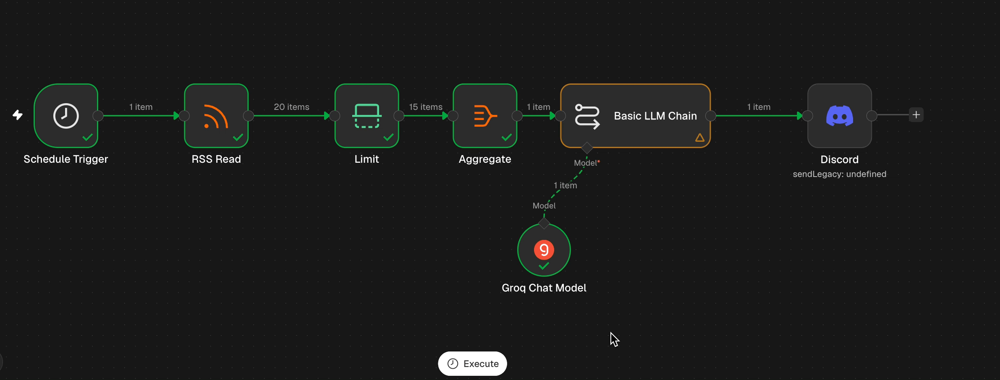

# 📰 Daily AI News Digest

> **A no-code AI automation that reads Hacker News every morning, uses an LLM to pick the 5 stories that matter most to a full-stack developer, and delivers them to Discord at 9:00 AM sharp.** ☕


**Project 1 of 10** in my _AI Automation Roadmap: Zero to 10 Projects_ 🗺️

---

## 🎬 Demo



**📬 What lands in Discord every morning:**

````text
1. AWS Lambda Web Functions keep billing memory about seven minutes after the last request <https://www.easel.sh/blog/lambda-web-functions-idle-memory>
2. ExcalidrawZ provides a local native Excalidraw app for macOS and iOS <https://github.com/chocoford/ExcalidrawZ>
3. smolmaxxing shows how to run LLMs on small, older devices <https://github.com/hyperionaidev/smolmaxxing/>
4. Guide to fitting four 32 GB resizable GPU bars behind a PCIe switch on Linux <https://doug.sh/posts/gpu-bars-behind-a-pcie-switch/>
5. AMD interview discusses Zen 6 architecture and performance expectations <https://chipsandcheese.com/p/talking-zen-6-with-mike-clark-at>

---

## 🤔 The Problem

Hacker News has 30 front-page stories at any moment. Most aren't relevant to my day-to-day work (Next.js, Node, TypeScript), and scrolling through them every morning is a time sink.

## 💡 The Solution

Let an LLM act as a **personal tech editor**: read the headlines, filter for what's useful to a full-stack developer, and send me a short 5-line briefing on my phone before I start work. **Zero manual effort, every day.**

---

## ⚙️ How It Works

```mermaid
flowchart LR
    A["⏰ Schedule<br/>9:00 AM PKT"] --> B["📡 RSS Read<br/>Hacker News"]
    B --> C["✂️ Limit<br/>Top 15"]
    C --> D["📦 Aggregate<br/>15 items → 1"]
    D --> E["🧠 LLM Chain<br/>Groq · openai/gpt-oss-120b"]
    E --> F["💬 Discord<br/>Webhook"]
````

|  #  | Node                          | What it does                                                                 |
| :-: | ----------------------------- | ---------------------------------------------------------------------------- |
|  1  | ⏰ **Schedule Trigger**       | Fires every day at 9:00 AM (Asia/Karachi)                                    |
|  2  | 📡 **RSS Read**               | Pulls the Hacker News front page from `hnrss.org/frontpage`                  |
|  3  | ✂️ **Limit**                  | Keeps the top 15 stories, which cuts noise and token cost                    |
|  4  | 📦 **Aggregate**              | Merges 15 separate items into **one** list so the LLM sees them all together |
|  5  | 🧠 **Basic LLM Chain** + Groq | Picks the 5 most useful stories and rewrites them in plain English           |
|  6  | 💬 **Discord**                | Posts the briefing to my private `#daily-digest` channel                     |

### 🧠 The Prompt

```text
You write a morning tech briefing for a full-stack developer (Next.js, Node, TypeScript).
From the headlines below, pick the 5 most useful ones.

Rules:
- Exactly 5 lines, numbered 1 to 5
- Max 15 words per line, plain English, no hype words
- End each line with its link wrapped in angle brackets, like <https://example.com>
- Do not invent details that aren't in the headline

Headlines:
{{ $json.items.map(i => '- ' + i.title + ' (' + i.link + ')').join('\n') }}
```

---

## 🛠️ Tech Stack

| Tool                     | Role                                       |
| ------------------------ | ------------------------------------------ |
| 🔀 **n8n** (self-hosted) | Workflow orchestration                     |
| 🐳 **Docker Compose**    | Runs n8n locally with persistent storage   |
| ⚡ **Groq API**          | Fast LLM inference (`openai/gpt-oss-120b`) |
| 📡 **hnrss.org**         | Hacker News as an RSS feed                 |
| 💬 **Discord Webhook**   | One-way delivery to my phone               |

---

## 🚀 Run It Yourself

**1️⃣ Start n8n**

```bash
git clone "git@github.com:Muhammad-Mukarram-Asad/Daily-News-Digest-P1-Automation.git"
cd <project-folder>
docker compose up -d
```

Open 👉 http://localhost:5678

**2️⃣ Import the workflow**
In n8n: **Workflows → Import from File** → choose `workflows/daily-ai-digest.json`

**3️⃣ Connect your accounts**

- 🔑 **Groq:** create an API key at [console.groq.com](https://console.groq.com) and add it to the Groq Chat Model node
- 🪝 **Discord:** Channel Settings → Integrations → Webhooks → copy the URL and add it to the Discord node

**4️⃣ Test & activate**
Click **Execute workflow** → check Discord → toggle **Active** or **Publish** in new versions of n8n ✅

---

## 🎯 Key Design Decisions

| Decision                           | Why                                                                                                                                                           |
| ---------------------------------- | ------------------------------------------------------------------------------------------------------------------------------------------------------------- |
| 🔀 **Workflow, not an AI agent**   | The steps are fixed and known in advance. An agent (an LLM choosing its own steps in a loop) would add cost, latency and unpredictability for no benefit.     |
| 📦 **Aggregate before the LLM**    | n8n runs each node once per item. Without Aggregate this would make **15 API calls** instead of **1**, and the LLM couldn't compare stories to pick the best. |
| 🌡️ **Temperature 0.3**             | A low temperature keeps output consistent and reduces made-up details.                                                                                        |
| 🔗 **Links in `<angle brackets>`** | Stops Discord from generating 5 large preview cards, so the message stays clean and scannable.                                                                |
| ✂️ **`.slice(0, 1990)` on output** | A safety net for Discord's 2000-character limit: the message is truncated instead of failing.                                                                 |
| 💬 **Discord instead of Telegram** | Already on my phone, and a webhook needs no bot setup for one-way posting.                                                                                    |

---

## 📚 What I Learned

### 🔀 Automation & n8n

- ✅ How **item-based execution** works in n8n, and why **Aggregate** is the key to batching
- ✅ Testing each node in isolation with **Execute step** before wiring the full flow
- ✅ The difference between a **manual test run** and an **active scheduled workflow**
- ✅ Debugging expressions by shrinking them to the smallest working piece (`{{ $json.items.length }}`) and building back up

### 🧠 LLMs & Prompt Engineering

- ✅ **Same model, very different output.** I ran a vague prompt (_"summarize these"_) against a strict one with rules and compared the results:

<!-- Paste your two real outputs here — this comparison is the most interesting part of the README -->

| 😵 Vague prompt |
| --------------- |

[{
"text": "**Summaries**\n\n| # | Title / Source | Core Summary |\n|---|----------------|--------------|\n| 1 | **Israeli airstrike on Nasser hospital in Gaza killed surgeon and others** – *The Guardian* (Nov 12 2026) | An Israeli airstrike hit Gaza’s Nasser Hospital, killing a surgeon and several other patients/medical staff. The report details the casualties, the hospital’s role in the conflict zone, and reactions from humanitarian groups calling the strike a possible violation of international law. |\n| 2 | **Nvidia Allegedly Engineered Scarcity by Funding AI Startups to Buy Its GPUs** – *TechPowerUp* | The article alleges that Nvidia covertly financed AI‑startup ventures and encouraged them to purchase large volumes of Nvidia GPUs, creating an artificial shortage that drove up prices and limited availability for other customers. It discusses the alleged strategy, market impact, and responses from industry analysts. |\n| 3 | **ggml v1.0.0** – *GitHub release* | The ggml project announced its first stable release (v1.0.0). The release notes highlight major performance improvements, new tensor operations, and a simplified API for building lightweight machine‑learning models that run on CPUs without GPU acceleration. |\n| 4 | **Nvidia director sold nearly $1B in stock weeks before the Jensen Huang scandal** – *Yahoo Finance* | A senior Nvidia board member reportedly sold almost $1 billion worth of company shares shortly before a high‑profile controversy involving CEO Jensen Huang (details of the scandal are not disclosed in the headline). The piece examines the timing, potential insider‑trading concerns, and market reaction. |\n| 5 | **Security Agencies Worldwide Found to Use Ad‑Based Surveillance System** – *Citizen Lab* | Research reveals that multiple national security agencies have adopted a commercial advertising‑tracking platform for mass surveillance. The report outlines how the system harvests user data, the legal/ethical implications, and recommendations for policy reform. |\n| 6 | **Elephants found to be increasingly isolated leading to fractured social networks** – *UCSD Today* | New field research shows that African/Asian elephant populations are experiencing higher rates of social isolation, breaking up long‑standing matriarchal bonds. Causes include habitat fragmentation, poaching pressure, and climate‑driven resource scarcity. |\n| 7 | **Amtrak booking system experiencing major issues amid nationwide FAA ground stop** – *Fox 5 DC* | Amid a nationwide FAA ground stop, Amtrak’s online ticketing platform suffered outages, leaving travelers unable to book or modify trips. The article links the technical glitch to increased traffic on transportation‑related services during the air‑traffic disruption. |\n| 8 | **Philip Roth and David Remnick getting personal (2001)** – *Salmagundi* | A 2001 essay explores the friendship and literary dialogue between novelist Philip Roth and *New Yorker* editor David Remnick, focusing on their personal correspondences, mutual influence, and the ways their private lives intersected with their public work. |\n| 9 | **Unsloth Qwen3.8‑27B Quantizations – Dynamic v3.1 Update** – *Unsloth.ai* | The latest Unsloth release (v3.1) adds dynamic quantization support for the Qwen‑3.8‑27B language model, improving inference speed and reducing memory usage while preserving accuracy. The documentation provides benchmark results and integration steps. |\n| 10 | **What Happened to 3Com?** – *DFARQ* | A retrospective examines the rise and fall of networking hardware company 3Com, covering its early successes, strategic missteps, competition with Cisco, and eventual acquisition by HP in 2010. The piece draws lessons about tech‑industry consolidation. |\n| 11 | **Show HN: Live map of U.S. flights during tonight's FAA nationwide ground stop** – *Grounds.top* | A community‑built web app visualizes real‑time flight data across the United States, highlighting which flights were delayed, rerouted, or cancelled during the FAA’s temporary nationwide ground stop on Nov 13 2026. |\n| 12 | **Terminal borders that don’t cost a cell** – *Joshka.net* | The article proposes a design concept for “cell‑free” terminal borders—physical or digital demarcations that separate airport terminals without relying on cellular‑based navigation or communication, aiming to improve passenger flow and reduce reliance on mobile devices. |\n| 13 | **How Not to Build a Music Player** – *Alicia Hraghi’s blog* | A post‑mortem of a failed open‑source music‑player project, detailing common pitfalls such as over‑engineering UI, neglecting cross‑platform audio APIs, and ignoring user feedback. The author shares lessons for developers building media applications. |\n| 14 | **Live airband on all frequencies from KORS. Victoria, CA also ground stopped** – *Orcas Airband* | KORS (a community radio station in Victoria, CA) streamed a live “airband” broadcast across all aviation frequencies, providing real‑time commentary during the FAA ground stop. The site also listed affected flights and offered updates. |\n| 15 | **FAA issues national ground stop – lifted 4.5 hours later** – *NBC News* | The FAA ordered a nationwide ground stop for departing flights on Nov 13 2026 due to safety concerns (weather‑related congestion). The restriction was lifted after 4.5 hours, and the article outlines the cause, impact on travelers, and steps taken to prevent future occurrences. |"
}]

| 🎯 Strict prompt |
| ---------------- |

[{
"text": "1. Nvidia allegedly created GPU scarcity by funding AI startups to purchase its chips <https://www.techpowerup.com/354814/nvidia-allegedly-engineered-scarcity-by-funding-ai-startups-to-buy-its-gpus> \n2. Ggml released version 1.0.0, a low‑level tensor library for machine‑learning inference <https://github.com/ggml-org/ggml/releases/tag/v1.0.0> \n3. Unsloth updated Qwen3.8‑27B quantization to dynamic v3.1, improving model size and speed <https://unsloth.ai/docs/models/qwen3.8> \n4. Security agencies worldwide use ad‑based surveillance systems, raising privacy concerns for web developers <https://citizenlab.ca/security-agencies-worldwide-found-to-use-ad-based-surveillance-system/> \n5. Show HN: live map of U.S. flights during FAA ground stop demonstrates real‑time data handling <https://grounds.top/>"
}]

- ✅ Writing **output contracts** (exact line count, word limit, link format) so LLM output can go straight into another system
- ✅ Using low temperature and "don't invent details" rules to reduce hallucination

### 🔌 Integrations

- ✅ **Webhooks vs bots:** a webhook can only _post_. Reading replies, buttons or images needs a full bot (coming in later projects with `discord.js`)
- ✅ Discord platform limits: 2000-character messages and link preview behaviour

### 🐳 DevOps Basics

- ✅ Running n8n with **Docker Compose** and named volumes for persistent data
- ✅ Why `docker compose down -v` is dangerous (it deletes the volume, including all workflows and credentials)
- ✅ Container restart policies (`unless-stopped`) and timezone configuration (`GENERIC_TIMEZONE`)

---

## ⚠️ Known Limitations

- 💻 **Runs on my laptop.** If the Mac is asleep at 9:00 AM, that day's digest is skipped (n8n doesn't backfill missed runs).
- 🔁 **No retry logic yet.** If Groq or the RSS feed is down, that run fails silently.
- 📰 **Single source.** Only Hacker News for now.

## 🔮 Future Improvements

- [ ] ☁️ Deploy to a VPS for 24/7 uptime
- [ ] 🔔 Add an error workflow that alerts me in Discord when a run fails
- [ ] 📰 Add more sources (dev.to, GitHub Trending, Reddit r/webdev)
- [ ] 🧹 Skip stories already sent on previous days
- [ ] 🟦 Rebuild in **TypeScript** with the Vercel AI SDK + Zod for typed, validated output

---

## 📁 Project Structure

```text
01-daily-news-digest/
├── 🐳 docker-compose.yml        # n8n container setup
├── 🔀 workflows/
│   └── daily-digest.json        # Exported n8n workflow
├── 🎬 docs/
│   └── demo.gif                 # Demo recording
├── 🙈 .gitignore
└── 📖 README.md
```

---

## 🗺️ Part of a Bigger Journey

This is **Project 1 of 10** in my AI Automation Roadmap, going from no-code tools to production TypeScript AI apps.

| Phase                    | Projects | Stack                     |
| ------------------------ | -------- | ------------------------- |
| 🟢 No-code foundations   | 1–2      | n8n                       |
| 🔵 Code-first automation | 3–10     | TypeScript · AI SDK · Zod |

---

<div align="center">

### 👋 Built by **Mukarram Asad**

Full-Stack Developer · Karachi, Pakistan 🇵🇰
_Next.js · React · TypeScript · Node.js · MongoDB_

⭐ **If you found this useful, consider giving it a star!**

</div>
